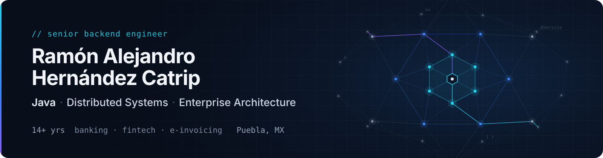
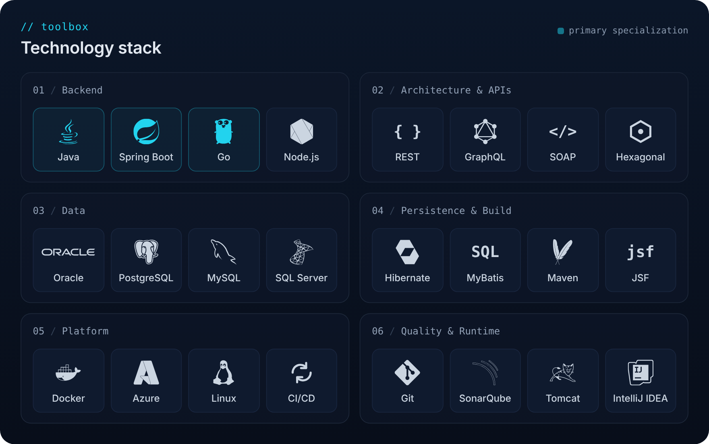
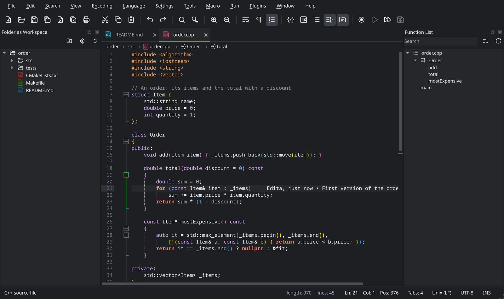

  

  <b>Senior Backend Engineer</b> &nbsp;·&nbsp; Java &nbsp;·&nbsp; Distributed Systems &nbsp;·&nbsp; Banking &amp; Fintech 
  Puebla, Mexico &nbsp;·&nbsp; English (advanced) / Spanish (native)

<!-- Professional links: add LinkedIn or another public URL here once approved. -->

---

## About

I build and modernize backend systems where correctness and uptime are not optional. For more than 14 years I have worked on Java platforms for **banking, financial services and electronic invoicing**: transactional services, high-availability infrastructure, enterprise integrations and the slow, careful work of moving legacy systems forward without breaking them.

Today I work as a Senior Software Engineer at **Mercado Libre**, on high-demand backend services, production stability and the migration of Java microservices to Go. Before that I spent several years building Spring Boot microservices with Ports and Adapters architecture for a large bank, and six years leading the development of CFDI electronic invoicing and stamping platforms.

Java is my primary language. Go and Node.js are part of my day-to-day backend toolbox.

---

## Core engineering expertise

<table>
<tr>
<td width="50%" valign="top">

**Backend engineering** 
Java SE / EE, Spring Boot, Spring Security, Go, Node.js. Batch and bulk processing for high-criticality workloads.

**Software architecture** 
Microservices, Hexagonal architecture (Ports and Adapters), REST and GraphQL APIs, legacy modernization.

**Distributed systems** 
High-availability transactional services, production troubleshooting, bottleneck analysis, monitoring and stability work.

</td>
<td width="50%" valign="top">

**Databases** 
Oracle, PostgreSQL, MySQL, SQL Server. Hibernate, MyBatis.

**Cloud and infrastructure** 
Docker, Microsoft Azure, Linux, CI/CD, production deployments.

**Enterprise integration** 
SOAP and REST integrations, CFDI and SAT fiscal services, document processing, HSM-backed signing and encryption.

</td>
</tr>
</table>

  

---

## Experience

| Period | Role | Company | Focus |
|---|---|---|---|
| 2025 – present | Senior Software Engineer | **Mercado Libre** | High-demand retail and transportation backends · Java → Go migration · production stability and monitoring |
| 2020 – 2025 | Senior Java Backend Engineer | **INGENIOSI / Anzen Soluciones** | Spring Boot microservices for a large bank · Ports and Adapters · GraphQL and REST · batch optimization · Spring Security |
| 2019 | Java Backend Developer | **Altavista Software** | Enterprise banking applications · legacy process modernization (Java 8, Linux cron) · SonarQube technical-debt analysis |
| 2013 – 2019 | Development Coordinator / Senior Developer | **STO Consulting** | CFDI electronic invoicing and stamping · SAT integrations (SOAP, REST, Azure) · HSM security · technical coordination |
| 2012 – 2013 | Java Developer | **System &amp; Solutions** | Insurance and portfolio management platform on Java and Oracle |
| 2010 – 2011 | Software Developer | **BUAP** | Digital image processing and medical analysis systems |

B.Sc. in Computer Science, Benemérita Universidad Autónoma de Puebla · Oracle Certification · Scrum Fundamentals Certified

---

## How I structure services

Most of my enterprise work has been on services shaped like this: the business rules sit in the middle, and every protocol, database and external system is an adapter that can be replaced or tested in isolation.

  

A general reference model. It is not a diagram of any employer's or client's system.

---

## Featured project

### [Edita](https://github.com/alktrip/edita) — the Notepad++ experience, built for Linux

A native text and code editor in **C++20 and Qt 6** on the Scintilla and Lexilla engine. It reads Notepad++ configuration files, implements its plugin API, and adds the tools a developer expects today: LSP, Git, an integrated terminal and project tasks.

  

**Why it is interesting from an engineering point of view**

- **API compatibility instead of binary compatibility.** Notepad++ plugins are Win32 DLLs. Edita exposes the same `NPPM_*` / `NPPN_*` messages through a C API and a Win32 compatibility layer on Qt, so plugins can be rebuilt from their original source for Linux.
- **A signed plugin supply chain.** [edita-plugins](https://github.com/alktrip/edita-plugins) builds each plugin from a pinned upstream tag (with SHA-256) plus patches, in CI for x86_64 and arm64, and publishes an Ed25519 (minisign) signed catalog. The editor verifies the signature and each package hash before installing.
- **Tested like a product.** 79 Qt Test suites, CI on x86_64 and arm64, and a separate AddressSanitizer + UndefinedBehaviorSanitizer job.

<b>Architecture diagram</b>

 

  

`C++20` `Qt 6` `Scintilla` `CMake` `LSP` `GitHub Actions` &nbsp;·&nbsp; GPL-3.0 &nbsp;·&nbsp; [Releases](https://github.com/alktrip/edita/releases) &nbsp;·&nbsp; [Plugin SDK](https://github.com/alktrip/edita/blob/main/docs/plugins.md)

### Also on GitHub

| Project | What it is | Stack |
|---|---|---|
| [edita-plugins](https://github.com/alktrip/edita-plugins) | Reproducible build recipes and the signed plugin catalog for Edita | Python · Bash · GitHub Actions |
| [Catrip Connect](https://github.com/alktrip/catrip-multichat-electron) | Multi-account WhatsApp Web desktop client for Linux with isolated sessions and global shortcuts | Electron · TypeScript · Playwright |
| [CatripPlayer](https://github.com/alktrip/catrip-player) | Desktop launcher that brings streaming services into one window | Electron · TypeScript |

My Java and banking work lives in private enterprise codebases. The repositories above are personal open-source projects.

---

## Engineering principles

- **Correctness first** in transactional code: explicit boundaries, idempotent operations, failure modes designed up front.
- **Architecture that survives change**: domain logic isolated from frameworks, adapters at the edges.
- **Pay down technical debt deliberately**: measure it, prioritize it, remove it in small safe steps.
- **Operate what you build**: monitoring, readable logs and fast diagnosis in production.
- **Security by default** for financial data: least privilege, secrets out of code, cryptography done with proper key management.
- **Performance from evidence**: profile, find the bottleneck, then optimize.

---

  Open to conversations about backend engineering, distributed systems and platform modernization.

